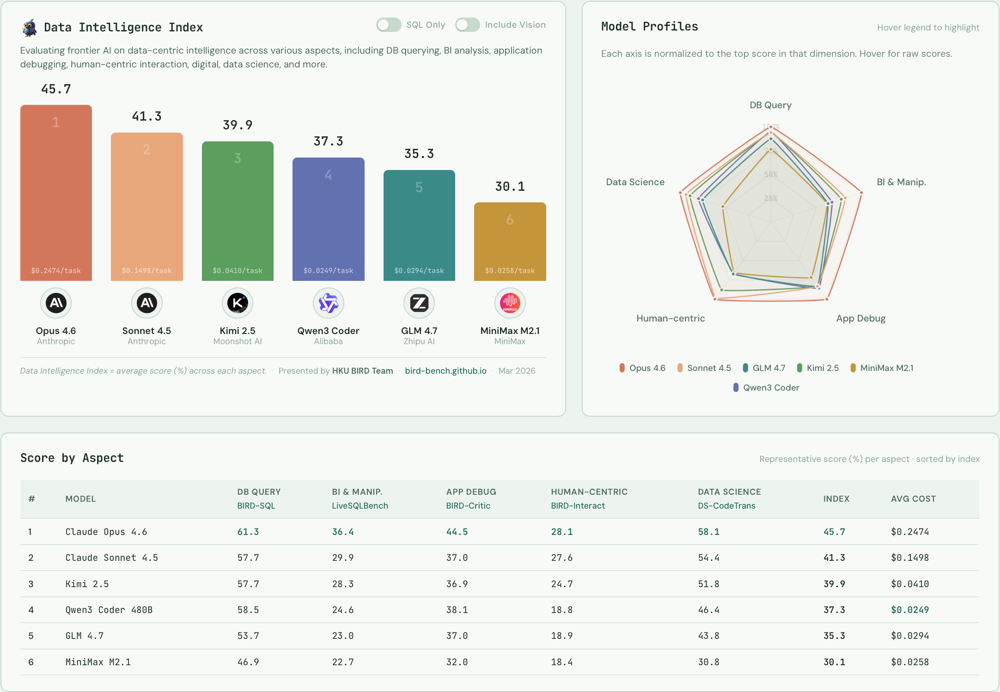
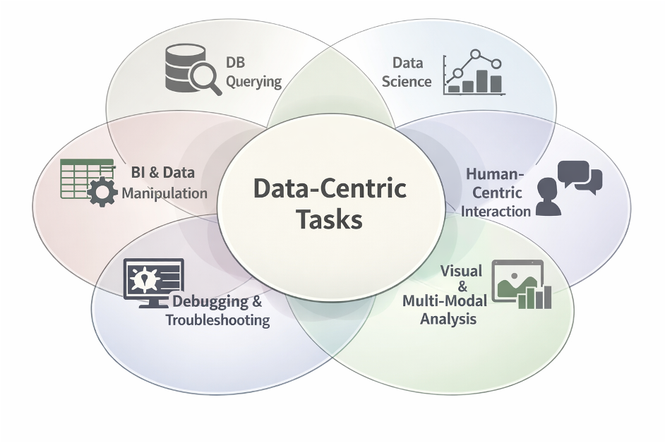

# Data Intelligence Index   

[](https://livesqlbench.ai/data-intelligence-index/)
[](https://livesqlbench.ai/data-intelligence-index/dashboard)
[](LICENSE)

A comprehensive evaluation of frontier AI models on data-centric challenges, from DB querying and BI analysis to application debugging, human-centric interaction, digital, data science, and more.

Presented by  [HKU BIRD Team](https://bird-bench.github.io/)

<p align="center">
  
  <br/>
  <em>Initial ranking of some leading models. See the <a href="https://livesqlbench.ai/data-intelligence-index/dashboard">Dashboard</a> for full results.</em>
</p>

> All models and benchmarks are evaluated in the End-to-End prompting-based way. The Index averages representative scores across all aspects equally. When aspects include multiple sub-benchmarks, an instance-weighted average is computed to reflect each benchmark's relative size.

## Why Data Intelligence Index?

Most Models and Agents evaluations focus on general reasoning, coding, or chat quality, but **real data work is harder and more diverse**: it spans querying, Business Intelligence (BI) analysis, DB operations (CRUD), debugging, multi-turn interaction, multi-modal querying, data science, and more aspects. 


<p align="center">
  
  <br/>
  <em>Various aspects of data-centric intelligence involved in real-world data work.</em>
</p>

The **Data Intelligence Index** is our attempt to measure the data intelligence comprehensively. We evaluate frontier AI models across various distinct aspects of data-centric intelligence, using multiple benchmarks developed by the HKU BIRD Team over the past three years, including:


| Aspect                         | Benchmark     | What It Tests                                              |
| ------------------------------ | ------------- | ---------------------------------------------------------- |
| **DB Querying**                | BIRD-SQL      | SQL translation from natural language                      |
| **BI Analysis & Manipulation** | LiveSQLBench  | BI analysis and Full database operations (CRUD)            |
| **DB App Debugging**           | BIRD-Critic   | Production application SQL issue diagnosis and repair      |
| **Human-centric Interaction**  | BIRD-Interact | Multi-turn agentic interactions with databases env. and user             |
| **Data Science**               | DS-CodeTrans  | Data science pipelines (e.g. DS code translation)                |
| **Digital**                    | BIRD-Vision        | Multi-modal reasoning combining images and structured data |
| **Efficiency**                 | SQL Optimization   | Query performance optimization (indexing, execution plans)  |
| **More ...**                   | Stay tuned!        |                                                             |

> If you'd like your benchmark or model to be included, please let us know via [bird.bench25@gmail.com](mailto:bird.bench25@gmail.com).


## Benchmark Overview: Evaluation Suite and Datasets


| Aspect                         | Benchmark                                                     | Subset                                                                       | Instances | Language / SQL Dialect                |
| ------------------------------ | ------------------------------------------------------------- | ---------------------------------------------------------------------------- | --------- | ------------------------------------- |
| **DB Querying**                | [BIRD-SQL (Mini Dev)](https://github.com/bird-bench/mini_dev) | [SQLite](https://huggingface.co/datasets/birdsql/bird_mini_dev)              | 500       | SQLite                                |
|                                |                                                               | [PostgreSQL](https://huggingface.co/datasets/birdsql/bird_mini_dev)          | 500       | PostgreSQL                            |
|                                |                                                               | [MySQL](https://huggingface.co/datasets/birdsql/bird_mini_dev)               | 500       | MySQL                                 |
|                                |                                                               | **Total**                                                                    | **1,500** |                                       |
| **BI Analysis & Manipulation** | [LiveSQLBench](https://github.com/bird-bench/livesqlbench)    | [Lite](https://huggingface.co/datasets/birdsql/livesqlbench-base-lite)       | 270       | PostgreSQL                            |
|                                |                                                               | [Full v1](https://huggingface.co/datasets/birdsql/livesqlbench-base-full-v1) | 600       | PostgreSQL                            |
|                                |                                                               | [Large v1](https://huggingface.co/datasets/birdsql/livesqlbench-large-v1)    | 480       | PostgreSQL                            |
|                                |                                                               | **Total**                                                                    | **1,350** |                                       |
| **DB App Debugging**           | [BIRD-Critic](https://github.com/bird-bench/BIRD-CRITIC-1)    | [SQLite](https://huggingface.co/datasets/birdsql/bird-critic-1.0-sqlite)     | 500       | SQLite                                |
|                                |                                                               | [Flash](https://huggingface.co/datasets/birdsql/bird-critic-1.0-flash-exp)   | 200       | SQLite                                |
|                                |                                                               | [PG-530](https://huggingface.co/datasets/birdsql/bird-critic-1.0-postgresql) | 530       | PostgreSQL                            |
|                                |                                                               | [Open](https://huggingface.co/datasets/birdsql/bird-critic-1.0-open)         | 570       | Mixed (PG, MySQL, SQL Server, Oracle) |
|                                |                                                               | **Total**                                                                    | **1,800** |                                       |
|                                | BIRD-Critic 1.5: SWE *(coming soon)*                          |                                                                              |           |                                       |
| **Human-centric Interaction**  | [BIRD-Interact](https://github.com/bird-bench/BIRD-Interact)  | [Lite](https://huggingface.co/datasets/birdsql/bird-interact-lite)           | 300       | PostgreSQL                            |
|                                |                                                               | [Full](https://huggingface.co/datasets/birdsql/bird-interact-full)           | 600       | PostgreSQL                            |
|                                |                                                               | [Mini-Interact](https://huggingface.co/datasets/birdsql/mini-interact)       | 300       | SQLite                                |
|                                |                                                               | **Total**                                                                    | **1,200** |                                       |
|                                | Tapilot-Crossing *(coming soon)*                              |                                                                              |           |                                       |
| **Data Science**               | DS-CodeTrans *(coming soon)*                                  | Data Querying                                                                | 300       | Python, PostgreSQL                    |
|                                |                                                               | Data Management                                                              | 300       | Python                                |
|                                |                                                               | Deep Learning                                                                | 200       | Python                                |
|                                |                                                               | **Total**                                                                    | **800**   |                                       |
| **Digital**                    | BIRD-Vision *(coming soon)*                                   | Life Track                                                                   | 300       | SQLite + image input                  |
|                                |                                                               | Science Track                                                                | 300       | SQLite + image input                  |
|                                |                                                               | **Total**                                                                    | **600**   |                                       |
| **Efficiency**                 | SQL Optimization *(coming soon)*                              |                                                                              |           |                                       |
|                                |                                                               | **Grand Total**                                                              | **7,250** |                                       |


**How the Data Intelligence Index is calculated**: Each aspect's representative score is a sample-weighted average of its subsets. The Data Intelligence Index is the unweighted average across all aspects.


## Contributing and Contact

We welcome contributions from the community to push the frontier of data intelligence together. If you have any questions or suggestions, please feel free to contact us!

If you'd like a benchmark or model to be included, please let us know via [bird.bench25@gmail.com](mailto:bird.bench25@gmail.com).


## Citation

If you find this work useful, please cite:

BIRD-SQL:
```
@article{li2024can,
  title={Can llm already serve as a database interface? a big bench for large-scale database grounded text-to-sqls},
  author={Li, Jinyang and Hui, Binyuan and Qu, Ge and Yang, Jiaxi and Li, Binhua and Li, Bowen and Wang, Bailin and Qin, Bowen and Geng, Ruiying and Huo, Nan and others},
  journal={Advances in Neural Information Processing Systems},
  volume={36},
  year={2024}
}
```

LiveSQLBench:
```
@misc{livesqlbench2025,
  author       = {BIRD Team},
  title        = {LiveSQLBench: A Dynamic and Contamination-Free Benchmark for Evaluating LLMs on Real-World Text-to-SQL Tasks},
  year         = {2025},
  howpublished = {https://github.com/bird-bench/livesqlbench},
  note         = {Accessed: 2025-05-22}
}
```

BIRD-Interact:
```
@inproceedings{
huo2026birdinteract,
title={{BIRD}-{INTERACT}: Re-imagining Text-to-{SQL} Evaluation via Lens of Dynamic Interactions},
author={Nan Huo and Xiaohan Xu and Jinyang Li and Per Jacobsson and Shipei Lin and Bowen Qin and Binyuan Hui and Xiaolong Li and Ge Qu and Shuzheng Si and Linheng Han and Edward Alexander and Xintong Zhu and Rui Qin and Ruihan Yu and Yiyao Jin and Feige Zhou and Weihao Zhong and Yun Chen and Hongyu Liu and Chenhao Ma and Fatma Ozcan and Yannis Papakonstantinou and Reynold Cheng},
booktitle={The Fourteenth International Conference on Learning Representations},
year={2026}
}
```

BIRD-Critic:
```
@inproceedings{
li2025swesql,
title={{SWE}-{SQL}: Illuminating {LLM} Pathways to Solve User {SQL} Issues in Real-World Applications},
author={Jinyang Li and Xiaolong Li and Ge Qu and Per Jacobsson and Bowen Qin and Binyuan Hui and Shuzheng Si and Nan Huo and Xiaohan Xu and Yue Zhang and Ziwei Tang and Yuanshuai Li and Florensia Widjaja and Xintong Zhu and Feige Zhou and Yongfeng Huang and Yannis Papakonstantinou and Fatma Ozcan and Chenhao Ma and Reynold Cheng},
booktitle={The Thirty-ninth Annual Conference on Neural Information Processing Systems},
year={2025}
}
```

